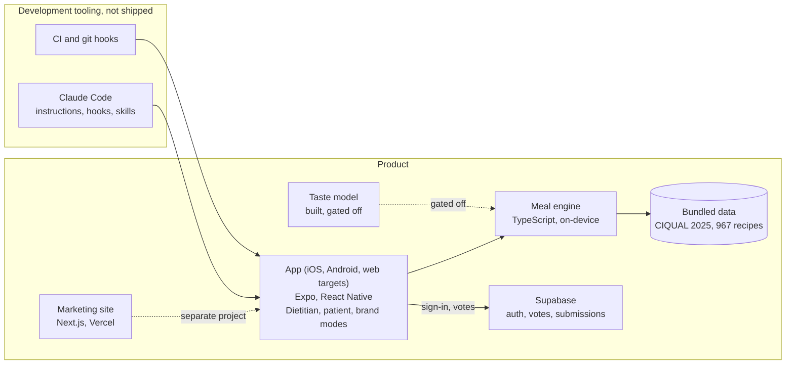

# NutriGen

NutriGen is a French-language nutrition app that generates personalised daily and weekly meal plans, for individuals and for dietitians managing several patients. Planning meals by hand is slow, and it is easy to miss an allergy, a diet or an energy target. NutriGen automates the arithmetic and the allergy and regime filters; the person can lock, swap and review every meal.

**Status: pre-release.** The app is not on any store yet, so I make no claims about users. The source code is private and proprietary; this overview is the only public technical description.

## About the developer

I'm Ludovic Marin. My background combines three fields:

- computer science studies in high school;
- a Licence in STAPS (the French sport-science degree), oriented towards sport and training;
- current studies in biology and nutrition.

I'm building NutriGen to combine these skills and help patients and dietitians.

## What the application does

Labels: *Working* (reachable by a user), *Partial*, *Experimental* (built but switched off), *Planned*.

- **Working: profiles and constraints.** Body measures, activity, goal, regime (omnivore, vegetarian, vegan, pescatarian, halal, kosher), 14 EU allergens, 13 cuisines, hot/cold preferences, pregnancy, and seven conditions (diabetes, hypertension, cholesterol, metabolic syndrome, osteoporosis, kidney insufficiency, sarcopenia).
- **Working: menus.** Day or seven-day plans generated on the device, with meal locking, ranked item swaps and an energy and macro summary; menus are not saved.
- **Working: shopping list, protein shaker, dietitian mode.** Aisle-grouped list with text export; shaker counted in the energy budget; patient profiles kept on the device.
- **Working when signed in: recipe votes.** Love and dislike votes change how often a recipe appears, through a simple rule rather than machine learning.
- **Partial: privacy tools.** Data export and opt-in analytics work; account deletion cannot yet complete on the server.
- **Partial: brand submissions, profile transfer.** Product submissions lack a review step; moving a profile between devices by code is not wired end to end.
- **Experimental: taste model.** A small logistic-regression model is bundled but gated off; a hand-written preference score is used instead.
- **Planned.** Dietitian–patient accounts and messaging, PDF export, multi-user enterprise spaces, store release.

## Architecture at a glance

The diagram separates the product from its development tools, which are not shipped.

## Main technical components

| Component | Responsibility | Technology | Current status |
|---|---|---|---|
| App | Profiles, menus, shopping, privacy, role-based navigation (not access control) | Expo SDK 54, React Native 0.81, React 19, expo-router, TypeScript, Zustand | Working in development; unpublished |
| Meal engine | Targets, filters, selection, portioning, daily convergence | TypeScript, on-device | Working |
| Data | Nutrient lookup, recipe pool | CIQUAL 2025 (3,484 foods); 967 recipes as bundled JSON | Working |
| Backend | Sign-in, votes, brand submissions, profile transfer | Supabase: Auth, Postgres with row-level security, one Edge Function | Partial |
| Marketing site | French presentation, legal pages | Next.js 16, React 19, Tailwind CSS, Vercel | Partial: live; buttons open a mail-client page |
| Taste model | Predict recipe likes | scikit-learn logistic regression, 23 features, JSON weights | Experimental |

## Meal-planning and nutrition engine

The whole pipeline runs on the device:

1. **Profile → energy target.** Mifflin–St Jeor basal metabolic rate, scaled by one of five activity levels and adjusted for goal (1,200 kcal floor) and pregnancy; protein targets are set in g/kg by mode. For kidney insufficiency the target is lowered and protein-dense recipes are filtered out to stay under KDIGO's 1.3 g/kg/day ceiling, a limit checked by tests, not enforced at run time and not covering the optional shaker.
2. **Constraints.** Allergen filters are strict at ingredient level: if an ingredient cannot be identified, the recipe is excluded for allergic users. Regime filters also work per ingredient but treat unknown ingredients as neutral. Cuisine and hot/cold preferences are never relaxed; if nothing fits, the meal is built from simple foods. Conditions add exclusions, score adjustments and protein targets.
3. **Selection.** Recipes are filtered and ranked; for lunch, dinner and snacks one is drawn from the top five with a seedable random generator, weighted by votes, while breakfast draws from the whole filtered pool.
4. **Portioning.** Quantities are scaled to each meal's share of the day and snapped to weighable steps; the day is then adjusted until it lands within 50 kcal of target (at most 120 moves), or the screen says it could not.

**References.** Used in code: CIQUAL 2025 (food composition), ANSES 2016 (protein references), KDIGO 2024 (kidney limits); PNNS 2026–2030 and GEM-RCN v2.0 feed display-only checks. A cited reference is not a certification: activity factors and goal offsets are unsourced product choices, and protein targets, salt and fat thresholds, halal and kosher rules await expert review.

## Data and backend

The engine runs without a network, but sign-in goes through Supabase, so a new user needs the backend to enter the app. Patient profiles stay in device storage, encrypted when the platform keystore is available. Supabase holds accounts, per-user recipe votes and brand product submissions. Its schema also defines practitioner–patient records, menus, messages and weight tracking; the app never writes to them; export reads them and deletion clears them. Row-level security is enabled on every table defined in the repository; I claim no live-configuration check or health-data certification.

## AI-assisted development workflow

The product calls no AI model at runtime; AI is only used to build it.

- **Claude Code** is my main environment: 249 of 389 commits (April–August 2026) carry a Claude co-author trailer (assisted commits, not authorship). Instruction files and brief templates are tracked; my own hooks, skills and memory are personal configuration.
- **Context and tooling.** A hook regenerates a compact project map after each code edit; a per-project memory lives outside the repository; a local dashboard shows token-usage estimates; six scheduled sessions are instructed only to write reports.
- **Agents and skills.** Delegation is one level deep: four brief templates (review, security, UI, implementation) kept in the repository, two named agents (review, design) and, more often now, scripted multi-agent audit workflows. In August 2026 I removed my manager/worker hierarchy after measuring that it had never been used, and in July an autonomous swarm.
- **Audit protocol.** Claims need executed proof, and an independent verifier tries to refute each high-severity finding; refuted findings are recorded. One audit found a test that always passed because it measured the filter it was checking; it was fixed.
- **OpenCode and T3 Code.** I also use them as alternative front-ends for coding agents. This is self-reported: neither leaves configuration or references in the repository, so I do not count them as technical integrations.

## Quality, validation, and current limitations

- **Tests.** 93 Vitest files run on every push; the last CI run (21 August 2026, the latest commit) passed 1,291 tests. Twelve invariant suites with seeded random profiles check, for example, that no detectable allergen is served (an independent check covers 11 of 14), regimes hold and the kidney ceiling holds. In two 60-profile samples without conditions or pregnancy the day landed within 1.2 kcal of the engine's own target (convergence, not clinical accuracy); protein tracks its target more loosely (median gap 17–24%).
- **Other checks.** TypeScript strict mode, ESLint, and opt-in local git hooks that scan commits for secrets and block pushes on unlisted high-severity advisories (the scanner lives outside the repository). There is no standalone benchmark.
- **Limitations.** I position NutriGen as decision support, not a medical device; it has had no clinical or regulatory assessment. The engine has no cross-day variety rule, micronutrient targets, kidney staging or lactation handling; adult formulas apply at every age; cross-contamination is not modelled; the osteoporosis calcium floor is not enforced. Dietitian–patient accounts, messaging, saved menus and a calendar do not exist. There are no end-to-end tests, and framework dependency advisories are accepted until a planned upgrade. Sign-in and cloud features need a Supabase project, which was unreachable at my last health check (6 November 2026).

## Next milestones

Goals, drawn from my project notes and the code:

1. Have a dietitian review the constants flagged as pending.
2. Upgrade Expo to retire the accepted dependency advisories.
3. Close the gaps a public release needs: server-side account erasure, an in-app disclaimer, data attributions and provenance, accurate website and app copy.
4. First store release (accounts, listings and credentials still to set up).
5. Later: dietitian–patient collaboration, and re-training the taste model once enough real votes exist.

*Facts checked by me against the private repository on 7 November 2026; not publicly verifiable.*
